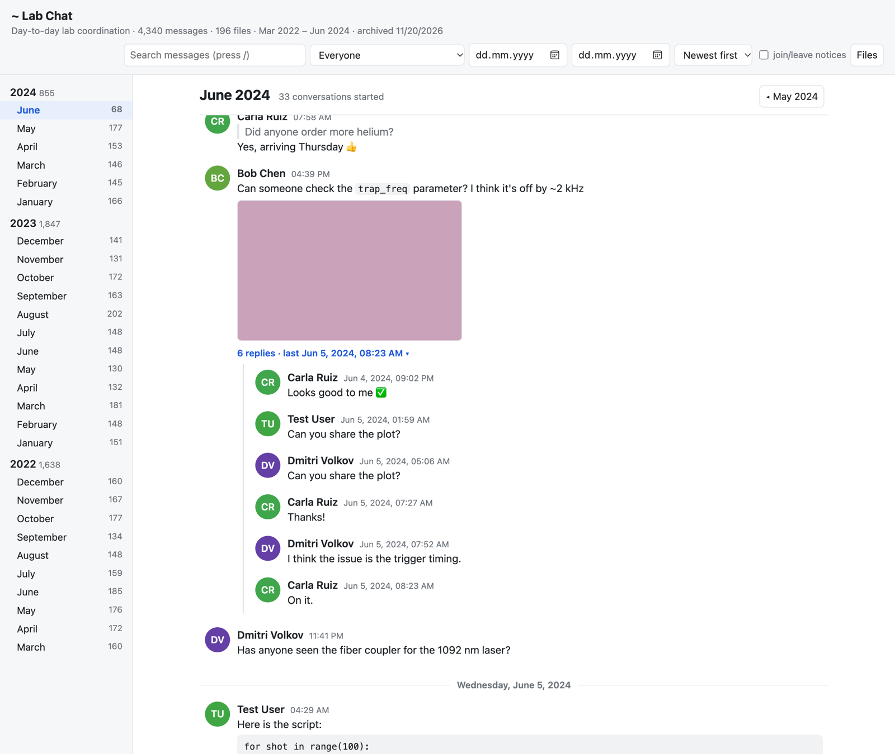
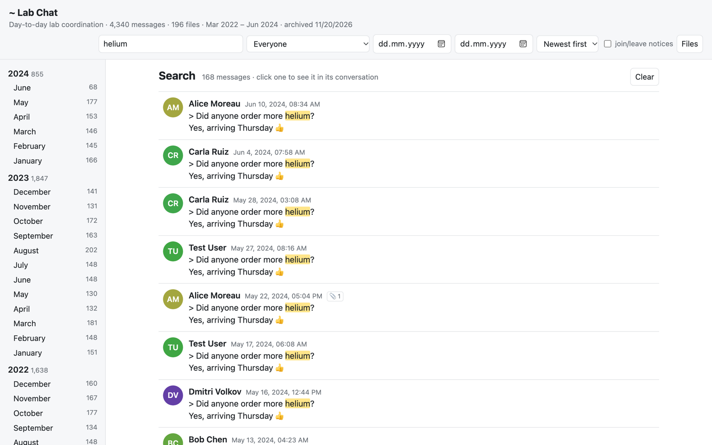

# Mattermost channel archive

Three scripts, plain Python 3 (no installs needed):

- `mm_archive.py` saves one channel — messages, threads, reactions, attachments — into
  `archive/archive.db` (SQLite) and `archive/files/`, using your own login (no admin needed).
- `mm_viewer.py` lets you browse and search that archive in your web browser.
- `mm_share.py` packs the archive into one clean .zip that others can unzip and browse.

## Preview

The viewer, showing made-up sample data:





## 0. Set up (once)

The scripts need Python 3.9 or newer and nothing else. The project keeps its own virtual
environment in `.venv`, so anything added later stays separate from other projects:

```bash
cd ~/Projects/mattermost-archive
python3 -m venv .venv          # only if .venv doesn't exist yet
source .venv/bin/activate      # each new terminal; `deactivate` to leave
```

There are no packages to install.

## 1. Get a login token

Easiest (works with SSO): log in to Mattermost in your browser, open DevTools →
Application (Chrome) / Storage (Firefox, Safari) → Cookies → your Mattermost site, and copy
the value of `MMAUTHTOKEN`. Don't log out until the export finishes; logging out cancels it.

Alternatives: a personal access token (Profile → Security, if your admin allows them).

## 2. Export the channel

The team and channel names are in the channel's URL:
`https://chat.example.org/<team>/channels/<channel>`.

```bash
python3 mm_archive.py --url https://chat.example.org --team <team> --channel <channel> --out archive
```

It asks for the token and hides what you paste. The token isn't shown on screen,
saved in your shell history, or written to the archive. (For unattended runs you can set
`MM_TOKEN` in the environment instead.)

- Interrupted, or the token expired? Run the same command again (with a fresh token if
  needed); it continues where it stopped.
- Running it again later refreshes the archive and only downloads attachments it's missing.
- `--no-files` skips attachments; `--workers N` sets parallel downloads (default 4).
- The archive is private chat data and is kept out of git: the project's `.gitignore`
  covers `archive*/` and `*.db`, and every archive folder gets its own `.gitignore`
  that ignores everything in it, whatever you name it.

## 3. Browse it

```bash
python3 mm_viewer.py archive
```

Your browser opens on the latest month. Pick months on the left, expand threads,
search (press `/`), filter by person or dates, or open **Files** to see every attachment.
Clicking a search result or file shows it in its conversation. The address bar keeps your
place, so you can bookmark a month, a message or a search. Stop with Ctrl-C.

The viewer is only reachable from your own computer and never changes the archive.

## 4. Share it

Don't zip the project folder itself: that would include `.venv`, `.DS_Store` and anything
else lying around. Instead:

```bash
python3 mm_share.py archive                 # -> <channel>-archive-<date>.zip
python3 mm_share.py archive --no-files      # messages only, much smaller
python3 mm_share.py --code-only             # just the scripts, no chat data
```

The zip contains a README for the recipients, the viewer, a fresh copy of the database and
the attachments, and nothing else. People's profile details from Mattermost (email address
etc.) are dropped from the copy; names stay. Your own archive folder isn't changed.
Recipients only need Python: unzip, then `python3 mm_viewer.py archive`.

## Querying with SQL

`archive.db` is an ordinary SQLite database, so you can also open it in
[DB Browser for SQLite](https://sqlitebrowser.org), Datasette, or Python.

| Table / view | What's in it |
|---|---|
| `messages` (view) | time, user, message, thread — the easiest place to start |
| `posts` | every post; `raw` holds the complete data from the API |
| `users`, `files`, `reactions` | people, attachments (`path` is relative to the archive folder), emoji reactions |
| `posts_fts` | full-text search index over messages |

```sql
-- messages mentioning "calibration", newest first
SELECT m.time, m.user, m.message
FROM posts_fts JOIN posts p ON p.rowid = posts_fts.rowid
JOIN messages m ON m.id = p.id
WHERE posts_fts MATCH 'calibration'
ORDER BY m.time DESC;

-- messages per person per year
SELECT substr(time, 1, 4) AS year, user, COUNT(*) FROM messages GROUP BY 1, 2;
```

## Limits

- Only what your account can see: deleted messages and earlier versions of edited messages
  aren't available to non-admins.
- Private channels: you must be a member.

## License

MIT — see [LICENSE](LICENSE).
